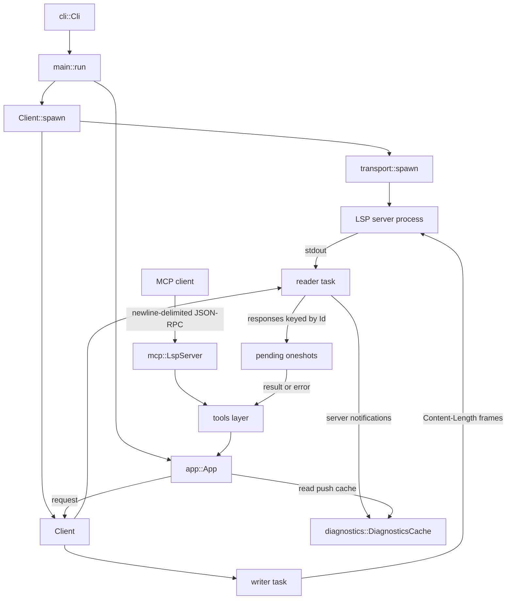

# Architecture

`lsp-mcp` is a single binary crate. It launches an LSP server, speaks the LSP
client protocol to it over the child process's stdio, and exposes that server to
an MCP client over its own stdio as a set of MCP tools. This page describes how
the current code is laid out, how data flows from the command line and an MCP
tool call down to the server and back, and the contract that keeps the two stdio
channels apart. It is the boundary that requirement R18 calls for.

## Module boundaries

The adapter is layered: a reusable LSP client (`lsp/`), a reusable tool layer
(`tools/`), and an MCP server (`mcp/`), wired together by `main.rs` through the
shared `App`. Nothing under `lsp/` knows about MCP.

| Module                           | Responsibility                                                                                                                                                                                                                                                                                                                                                                                                                                                                                                                                                                                                                                                                                                                                                                   |
| -------------------------------- | -------------------------------------------------------------------------------------------------------------------------------------------------------------------------------------------------------------------------------------------------------------------------------------------------------------------------------------------------------------------------------------------------------------------------------------------------------------------------------------------------------------------------------------------------------------------------------------------------------------------------------------------------------------------------------------------------------------------------------------------------------------------------------- |
| `src/main.rs`                    | Entry point. Initializes `tracing` (to stderr), parses the CLI, spawns and handshakes with the server, builds the shared `App`, and serves MCP over stdio until the transport closes.                                                                                                                                                                                                                                                                                                                                                                                                                                                                                                                                                                                            |
| `src/app.rs`                     | `App`: the state shared by the MCP server and every tool. Owns the `Arc<Client<ChildStdout, ChildStdin>>`, a `tokio::sync::Mutex<Documents>`, and the `Arc<DiagnosticsCache>`, and exposes per-feature capability predicates (`supports_definition`, `supports_references`, `supports_hover`, `supports_document_symbols`, `supports_workspace_symbols`, `supports_pull_diagnostics`, `supports_code_actions`, `supports_execute_command`, `supports_rename`, `supports_document_formatting`, `supports_document_range_formatting`) plus an `open_document(path)` helper that reads a file from disk and ensures the server has it open and a best-effort `refresh_documents(&[PathBuf])` the write tools call after a write so the document store matches disk.                 |
| `src/cli.rs`                     | `clap` (derive) parsing of `lsp-mcp <server-command> [-- <arg>...]`, capturing the server program and its forwarded arguments as an ordered `Vec<String>`.                                                                                                                                                                                                                                                                                                                                                                                                                                                                                                                                                                                                                       |
| `src/error.rs`                   | The `thiserror` [`Error`] enum (`SpawnFailed`, `Io`, `Framing`, `Protocol`, `Json`, `JsonRpc`, `Timeout`, `ServerExited`) and the crate `Result` alias. `anyhow` supplies context only at the `main` boundary.                                                                                                                                                                                                                                                                                                                                                                                                                                                                                                                                                                   |
| `src/lsp/transport.rs`           | `Content-Length` framing (`read_frame`/`write_frame`) generic over `AsyncRead`/`AsyncWrite`, plus `spawn(command, args)`, which wires a `tokio::process` child's stdio into the same framing.                                                                                                                                                                                                                                                                                                                                                                                                                                                                                                                                                                                    |
| `src/lsp/message.rs`             | The JSON-RPC 2.0 envelope (`Id`, `Request`, `Response`, `Notification`, `ErrorObject`) and thin builders that derive payloads from `lsp-types`, including `text_document_position_params` for position-based requests and `reference_params`/`document_symbol_params`/`workspace_symbol_params`/`document_diagnostic_params` for the read/explore tools, `code_action_params`/`execute_command_params` for the act tools, and `prepare_rename_params`/`rename_params`/`document_formatting_params`/`document_range_formatting_params` for the write tools. `initialize_params` advertises minimal client support for those features, including code-action literals/resolve, `WorkspaceEdit` document changes and resource operations, command execution, and rename/formatting. |
| `src/lsp/client.rs`              | `Client<R, W>`: the reader and writer tasks, the `initialize`/`initialized` handshake and captured `ServerCapabilities`, request/notification correlation, per-request timeouts, and exit detection.                                                                                                                                                                                                                                                                                                                                                                                                                                                                                                                                                                             |
| `src/lsp/documents.rs`           | `Documents`: per-URI version and text bookkeeping and the `didOpen`/`didChange`/`didClose` notifications, with `ensure_open(path, text)`.                                                                                                                                                                                                                                                                                                                                                                                                                                                                                                                                                                                                                                        |
| `src/lsp/mod.rs`                 | Re-exports the submodules and provides the `path_to_uri`/`uri_to_path` helpers.                                                                                                                                                                                                                                                                                                                                                                                                                                                                                                                                                                                                                                                                                                  |
| `src/diagnostics.rs`             | `DiagnosticsCache`: the background consumer of pushed `textDocument/publishDiagnostics` notifications, storing the latest `Vec<Diagnostic>` per URI with monotonic revision stamps and awaiting a newer revision under a bound.                                                                                                                                                                                                                                                                                                                                                                                                                                                                                                                                                  |
| `src/workspace_edit.rs`          | The shared, MCP-agnostic `WorkspaceEdit` application helper: `apply(&WorkspaceEdit)` and `apply_text_edits(&Uri, &[TextEdit])` write edits to disk, handling `changes` and `document_changes` (edits and create/rename/delete operations), descending-order in-file edits, and UTF-16 position conversion. Reused by the code-action apply tool and later write tools.                                                                                                                                                                                                                                                                                                                                                                                                           |
| `src/mcp/mod.rs`                 | The MCP layer entry point; re-exports `serve`.                                                                                                                                                                                                                                                                                                                                                                                                                                                                                                                                                                                                                                                                                                                                   |
| `src/mcp/server.rs`              | `LspServer`: the `#[tool_router]`/`#[tool_handler]` server, its `get_info` capabilities, and `serve`, which drives the newline-delimited stdio transport and waits for it to close.                                                                                                                                                                                                                                                                                                                                                                                                                                                                                                                                                                                              |
| `src/tools/mod.rs`               | The reusable tool infrastructure: the shared `PositionArgs` (`references` adds `ReferencesArgs`, `codeAction` adds `CodeActionArgs`, `applyCodeAction` adds the flat `ApplyCodeActionArgs`, `rename` adds `RenameArgs`, and `format` adds `FormatArgs`/`FormatRange`; `documentSymbol`/`diagnostics` share `FileArgs`; `workspaceSymbol` uses `WorkspaceSymbolArgs`), the 1-based→0-based `validate_position`/`position_at`/`validate_range`, the `LocationView`/`SymbolView` and `CallToolResult` builders, the code-context renderer, and the error→result mapping.                                                                                                                                                                                                            |
| `src/tools/definition.rs`        | The `definition` tool: a `textDocument/definition` request shaped into a structured result.                                                                                                                                                                                                                                                                                                                                                                                                                                                                                                                                                                                                                                                                                      |
| `src/tools/references.rs`        | The `references` tool: a `textDocument/references` request shaped into located views.                                                                                                                                                                                                                                                                                                                                                                                                                                                                                                                                                                                                                                                                                            |
| `src/tools/hover.rs`             | The `hover` tool: a `textDocument/hover` request, rendering `HoverContents` and the optional range.                                                                                                                                                                                                                                                                                                                                                                                                                                                                                                                                                                                                                                                                              |
| `src/tools/document_symbol.rs`   | The `documentSymbol` tool: a `textDocument/documentSymbol` request, decoding both response shapes into symbol views.                                                                                                                                                                                                                                                                                                                                                                                                                                                                                                                                                                                                                                                             |
| `src/tools/workspace_symbol.rs`  | The `workspaceSymbol` tool: a `workspace/symbol` request, reading each symbol's file on demand for context.                                                                                                                                                                                                                                                                                                                                                                                                                                                                                                                                                                                                                                                                      |
| `src/tools/diagnostics.rs`       | The `diagnostics` tool: a `textDocument/diagnostic` pull request when advertised, otherwise the push cache. Exposes the shared `file_diagnostics` helper the code-action tool reuses.                                                                                                                                                                                                                                                                                                                                                                                                                                                                                                                                                                                            |
| `src/tools/code_action.rs`       | The `codeAction` list tool: a `textDocument/codeAction` request shaped into indexed action views, gated on `codeActionProvider`. Its `list_actions` fetch is reused by the apply tool.                                                                                                                                                                                                                                                                                                                                                                                                                                                                                                                                                                                           |
| `src/tools/apply_code_action.rs` | The `applyCodeAction` write tool: re-lists, selects by index, resolves via `codeAction/resolve`, and applies a `WorkspaceEdit` through `workspace_edit` and/or a `Command` through `workspace/executeCommand`.                                                                                                                                                                                                                                                                                                                                                                                                                                                                                                                                                                   |
| `src/tools/rename.rs`            | The `rename` write tool: `textDocument/prepareRename` then `textDocument/rename`, applying the returned `WorkspaceEdit` through `workspace_edit`, gated on `renameProvider`.                                                                                                                                                                                                                                                                                                                                                                                                                                                                                                                                                                                                     |
| `src/tools/format.rs`            | The `format` write tool: whole-file `textDocument/formatting` or range `textDocument/rangeFormatting`, applying the returned `TextEdit[]` through `workspace_edit::apply_text_edits`.                                                                                                                                                                                                                                                                                                                                                                                                                                                                                                                                                                                            |

`Client` and the framing layer are generic over `R: AsyncRead + Unpin + Send` and
`W: AsyncWrite + Unpin + Send`, so the same code drives a spawned child's stdio in
production and a `tokio::io::duplex` pair in tests.

The crate also builds a test-only binary, `src/bin/fake-lsp-server.rs`, which the
process-level CLI and MCP tests spawn in place of a real server: it serves the
`initialize` handshake and a handful of canned requests so the whole adapter can
be exercised without a real language server. It is a test fixture, not part of
the adapter's runtime surface.

## Data flow

1. `main::run` parses the CLI and calls `Client::spawn(command, args)` from
   `src/lsp/client.rs`.
2. `Client::spawn` calls `transport::spawn`, which builds a `tokio::process`
   command with piped stdin/stdout and `kill_on_drop`, and constructs a
   `Client<ChildStdout, ChildStdin>` over those handles.
3. The handshake runs: `initialize` sends the request and stores the returned
   `ServerCapabilities`; `initialized` completes it.
4. `main` wraps the client in an `App` and serves `mcp::LspServer` over stdio.
5. An MCP client drives the server over stdio: `tools/list` returns the router's
   tools, and `tools/call` dispatches to a tool method that delegates to
   `src/tools/`.
6. A tool reads its arguments, opens the target document on demand through `App`,
   validates the position, and issues an LSP request through `App::client()`.
7. Requests go out through a `mpsc` channel drained by the writer task, which
   frames each message and writes it to the child's stdin.
8. The reader task frames the child's stdout and dispatches each message by
   shape: responses resolve the pending `oneshot` keyed by `Id`, server-to-client
   notifications are forwarded to a broadcast channel, and server-to-client
   requests are answered with a JSON-RPC `MethodNotFound` error. The
   `DiagnosticsCache` (`src/diagnostics.rs`) consumes that notification broadcast
   from startup, keeping the latest pushed `textDocument/publishDiagnostics`
   report per URI.
9. The tool converts the response into a `CallToolResult` and returns it to the
   MCP client.

For position-based work, `App::open_document(path)` reads the file, converts the
path to a URI, and calls `Documents::ensure_open`, which emits `didOpen` the first
time and `didChange` when the text differs, so a subsequent request is made
against a document the server knows. The text is returned to the tool so it can
validate the position and render context.

## The tool layer

Position-based tools share `PositionArgs`: a file path plus a **1-based** line and
column (what a person sees in an editor). `validate_position` checks them against
the document text — rejecting an empty path, a `0` line or column, and a position
past the end of the file — and converts to the 0-based `lsp_types::Position` the
protocol uses. Each tool returns a `CallToolResult` carrying a human-readable text
block and `structured_content` (the document URI, 1-based line and column, the
range end, and the surrounding code context), with the raw LSP payload included
where it adds fidelity. Expected failures — a bad argument, an unreadable file, or
a server that does not advertise the needed capability — are returned as `isError`
tool results that the client renders, never as panics or hidden protocol errors.

## The read/explore tools

The adapter exposes six read/explore tools, one per LSP request:

| Tool              | LSP request                                      | Arguments                      |
| ----------------- | ------------------------------------------------ | ------------------------------ |
| `definition`      | `textDocument/definition`                        | position                       |
| `references`      | `textDocument/references`                        | position + include_declaration |
| `hover`           | `textDocument/hover`                             | position                       |
| `documentSymbol`  | `textDocument/documentSymbol`                    | file                           |
| `workspaceSymbol` | `workspace/symbol`                               | query                          |
| `diagnostics`     | `textDocument/diagnostic` / `publishDiagnostics` | file                           |

`references`, `hover`, `documentSymbol`, and `workspaceSymbol` return the same
shaped results as `definition`: URI, 1-based position, surrounding code context,
and the raw LSP payload. The two symbol tools share a `SymbolView`
(name/kind/detail/container/location); the nested and flat response shapes are
both handled, and a workspace symbol's context is read on demand from its file
(best-effort). `hover` renders `HoverContents` (scalar, array, or markup) and the
optional range.

Each tool checks its capability **first**: `App` exposes one predicate per feature
(`supports_references`, `supports_hover`, `supports_document_symbols`,
`supports_workspace_symbols`, `supports_pull_diagnostics`), mirroring
`supports_definition`. When the server has not advertised the feature the tool
returns a clear `isError` result naming the missing capability (e.g.
`referencesProvider`) rather than sending a request that fails obscurely. This is
requirement R20.

`diagnostics` prefers **pull** (`textDocument/diagnostic`) when the server
advertises `diagnosticProvider`, and otherwise reads the **push** cache: it records
the file's current revision, opens the document (a server that publishes on
`didOpen` emits a fresh report), awaits a newer revision under a bounded timeout,
and falls back to whatever was already cached, reporting plainly when nothing has
arrived. Both mechanisms are reported through the result's `mechanism` field.

## The act/modify tools

The adapter exposes four act/modify tools: two for code actions (list and apply)
and two write tools (rename and format):

| Tool              | LSP request                                                                                | Arguments                             |
| ----------------- | ------------------------------------------------------------------------------------------ | ------------------------------------- |
| `codeAction`      | `textDocument/codeAction`                                                                  | position + include_diagnostics + only |
| `applyCodeAction` | `codeAction/resolve` + `workspace/executeCommand` (as needed) + the `WorkspaceEdit` helper | the list arguments + index + title    |
| `rename`          | `textDocument/prepareRename` + `textDocument/rename` + the `WorkspaceEdit` helper          | position + new_name                   |
| `format`          | `textDocument/formatting` / `textDocument/rangeFormatting` + `apply_text_edits`            | file + optional 1-based range         |

Listing and applying are **separate** so the agent can inspect the options before
committing to a write: `codeAction` never writes, and the write tools
(`applyCodeAction`, `rename`, `format`) do.

`codeAction` gates on `codeActionProvider`, opens the document on demand,
validates the shared 1-based position, builds a zero-width range there, gathers
the diagnostics at that position (unless `include_diagnostics` is `false`, through
the shared `file_diagnostics` helper the `diagnostics` tool also uses), sends
`textDocument/codeAction`, and returns one `ActionView` per action: a stable
`index` alongside the `title`, the optional `kind`/`isPreferred`/`disabled`, and
`hasEdit`/`hasCommand`.

`applyCodeAction` **re-fetches** the list from the same arguments, selects the
action at `index` (bounds-checked, so an out-of-range index is a clear error) and
optionally guards on `title` so index drift applies nothing rather than the wrong
action. When the chosen action carries neither `edit` nor `command`, it is resolved
through `codeAction/resolve` first. The resolved action is then applied: a
`WorkspaceEdit` is written to disk through the shared helper, a `Command` is run
through `workspace/executeCommand` (gated on `executeCommandProvider`), and when
both are present the edit is applied first and the command run after, matching the
protocol. The result reports the files changed, created, renamed, and deleted, and
the command executed.

`rename` **validates before editing**: it gates on `renameProvider`, opens the
document on demand, validates the shared 1-based position, and sends
`textDocument/prepareRename` to confirm the position names a renameable symbol and
to obtain the current name (from the `placeholder`, from the range's text, or
unknown for the server's default behavior). A `null` `prepareRename` result is a
clear `isError` that writes nothing. It then sends `textDocument/rename` with the
new name and applies the returned `WorkspaceEdit` through the shared helper; a
`null` edit is also a clear error. A server that supports rename but not
`prepareRename` returns an error naming `textDocument/prepareRename` rather than
making an unvalidated write. The result lists the old and new names and the files
changed.

`format` selects its mode from the arguments: an **absent** `range` formats the
whole file through `textDocument/formatting` (gated on
`documentFormattingProvider`), and a **present** 1-based `range` formats that range
through `textDocument/rangeFormatting` (gated on
`documentRangeFormattingProvider`). Formatting options are fixed (tab size 4,
spaces). A `null` or empty `TextEdit[]` is a "no changes" success that writes
nothing; otherwise the bare array is applied through
`workspace_edit::apply_text_edits` — exactly the shape that helper takes.

Both write tools gate on their capability **first**, naming the missing one
(`renameProvider`, `documentFormattingProvider`,
`documentRangeFormattingProvider`) in a clear `isError`, which is requirement R20.
After a write the adapter's in-memory `Documents` store would otherwise hold the
pre-edit text and version, so `App::refresh_documents` re-reads each
changed/created path and re-runs `ensure_open`, emitting `didChange` when the text
differs; a path that no longer exists is skipped and a refresh failure is logged
rather than failing the write.

The shared application helper lives in `src/workspace_edit.rs`. It is
MCP-agnostic — it depends only on `lsp-types`, `crate::error`, and `std::fs` — so
the rename and format tools reuse it unchanged. It handles both edit shapes
(`document_changes` preferred over `changes`, covering `TextDocumentEdit`s and
create/rename/delete resource operations), applies a file's edits in descending
range order so every earlier range stays valid, converts LSP positions from UTF-16
code units to byte offsets, runs resource operations in order, and reports the
paths it touched. A missing file, a non-file URI, and an out-of-range edit are all
clear errors, never panics.

## Concurrency and lifecycle

Two background tasks own the LSP I/O and never interleave frames: one reader and
one writer. Each request allocates a monotonically increasing `Id`, registers a
`oneshot` sender in a shared map, enqueues its frame, and awaits the response
under `tokio::time::timeout` (default 30 seconds). When the reader hits EOF or a
framing error it marks the client dead and fails every pending request with
`ServerExited`; a request that arrives once the client is dead fails immediately
with the same error rather than hanging.

The MCP server holds an `Arc<App>`, which keeps the `Client` (and, through it, the
spawned LSP child) alive for the whole MCP session. When the stdio transport
closes, `serve` returns and the `App`, `Client`, and child are dropped; dropping
the `Client` aborts its tasks and, because the child was spawned with
`kill_on_drop`, terminates the server.

## The stdout/stderr contract

stdout belongs entirely to the MCP transport and carries nothing but
**newline-delimited JSON-RPC** (one JSON object per line), which is what MCP over
stdio specifies. Every diagnostic goes to stderr: `main` configures
`tracing_subscriber` with `with_writer(std::io::stderr)`, errors are printed with
`eprintln!`, and no `println!` appears on a tool or request path. The spawned
server's own stderr is inherited, so its logs join the adapter's on stderr rather
than leaking onto stdout (R17).

## URI representation

`lsp-types` 0.97 represents document locations as `lsp_types::Uri` (backed by
`fluent-uri`), not `url::Url`. `url::Url` performs the filesystem-path ↔ URI
conversion (`from_file_path`/`to_file_path`) at the boundary, and the resulting
string is adapted to `lsp_types::Uri` when building protocol messages. See the
`path_to_uri` and `uri_to_path` helpers in `src/lsp/mod.rs`.

See the [requirements](requirements.md) for the numbered requirements these
boundaries serve.
